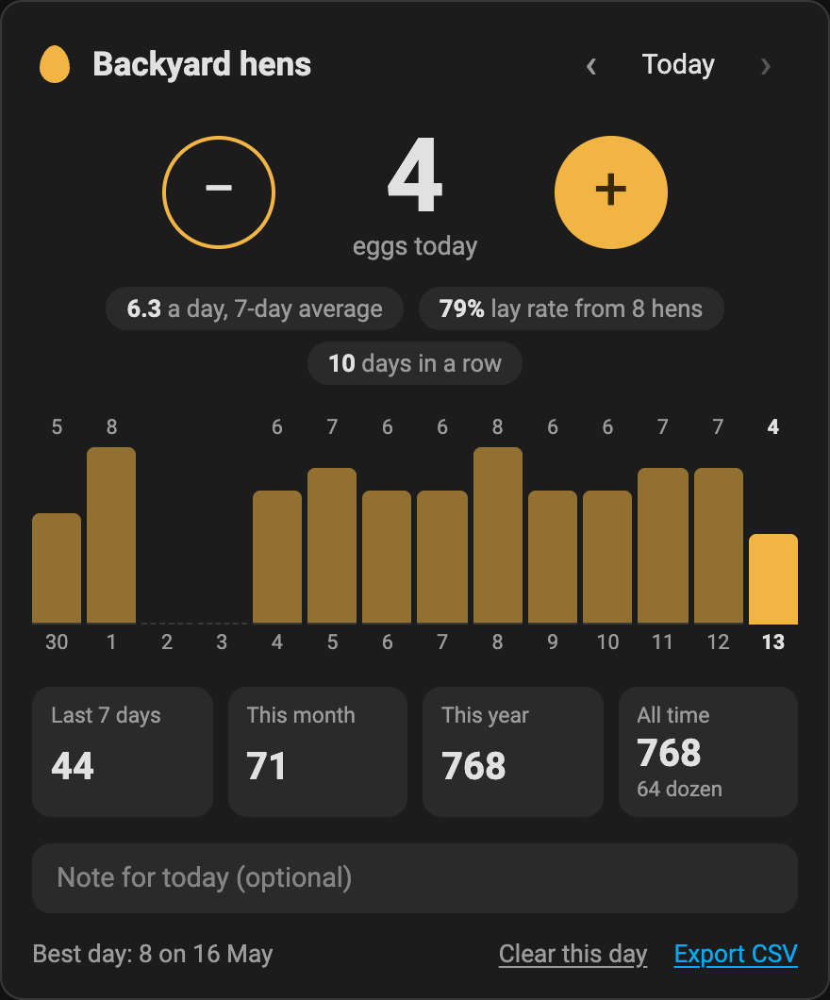
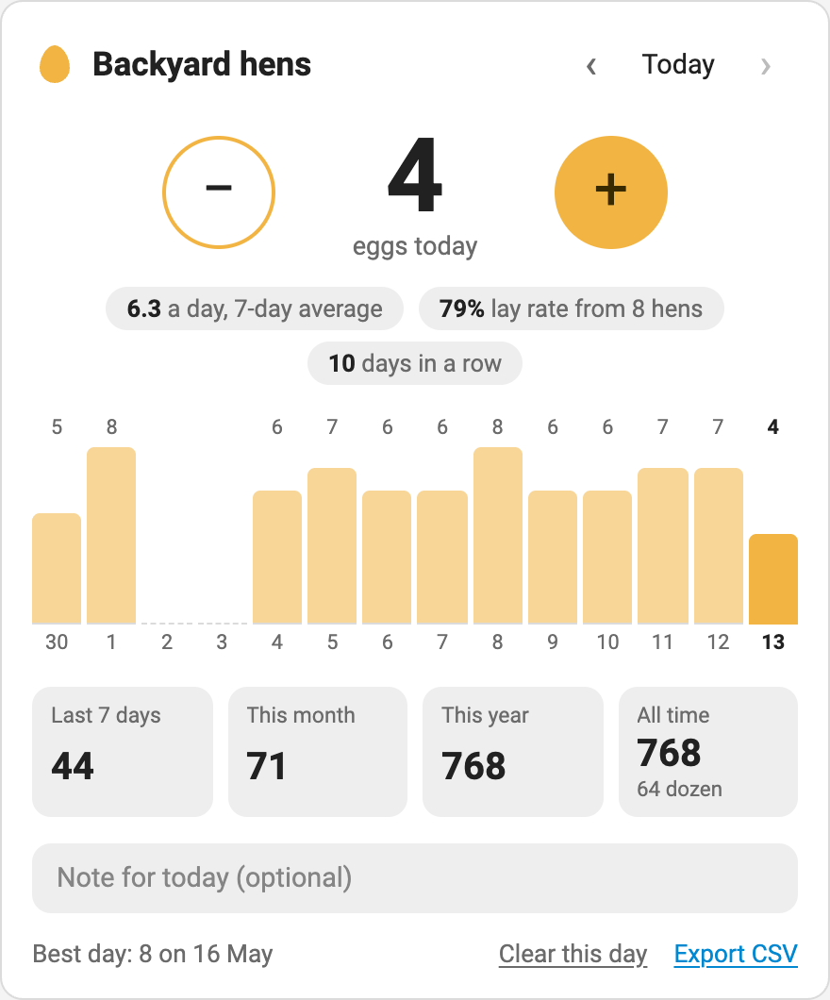
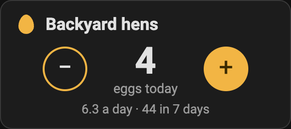

# Egg Track - a daily egg log for Home Assistant

Count the eggs your chickens lay each day. Log them from a dashboard card, a button, an NFC tag in
the coop or a voice command, and see how the flock is laying over the week, the month and the year.
Everything is stored in your own Home Assistant.

<p>
  
  
</p>

The screenshots use made-up data.

## Features

- **One tap to log an egg.** Big minus and plus buttons, or tap the number to type the day's total.
- **Fix or fill in past days.** Step back a day at a time, or tap any bar in the chart.
- **How the flock is laying.** Last 7 days, this month, this year and all time, a 7-day average, the
  lay rate for your number of hens, days in a row with eggs, and your best day.
- **"No eggs" is not the same as "not logged".** A day you haven't logged doesn't drag the average
  down until you say there were none.
- **Notes.** A line per day for a broody hen, a moult or a cracked egg.
- **Sensors, buttons and actions**, so automations can log eggs and dashboards can graph them.
  The running total feeds Home Assistant's long-term statistics.
- **More than one flock.** Keep hens and ducks apart.
- **Stays in step.** Log on one phone and every open card updates.
- **Your data.** Stored in Home Assistant, with a CSV export on the card.
- **Follows your theme**, light or dark.

## Installation

### Requirements

Home Assistant 2025.1 or newer.

### HACS

1. In HACS, open the menu (top right) and choose **Custom repositories**.
2. Add `https://github.com/ClermontDigital/EggTrack` with the type **Integration**.
3. Find **Egg Track** in HACS, download it, and restart Home Assistant.

### Manual

Copy `custom_components/egg_track` into your Home Assistant `config/custom_components` folder and
restart.

### Adding a flock

Go to **Settings > Devices & services > Add integration** and choose **Egg Track**. Give the flock a
name and, if you'd like a lay rate, the number of laying hens. Add the integration again for a
second flock. The hen count can be changed later under the flock's **Configure** button.

### The card

The card is installed with the integration. Edit a dashboard, choose **Add card** and search for
**Egg Track**, or add it in YAML:

```yaml
type: custom:egg-track-card
```

| Option | Default | What it does |
|---|---|---|
| `entry_id` | your first flock | Which flock to show. Pick it from the list in the card editor. |
| `view` | `full` | `full` shows the chart and totals. `compact` is just today's count and the buttons. |
| `days` | `14` | Days in the bar chart, from 7 to 60. |
| `title` | the flock's name | A different heading. |



Tap the number to type an exact total. On a day nobody has logged, **No eggs today** records a zero.
**Clear this day** forgets a day's count and note. The yolk colour can be changed in a theme with
`egg-track-accent`.

If the card doesn't appear after installing, refresh the browser. On a dashboard managed in YAML,
add `/egg_track/egg-track-card.js` as a JavaScript module resource.

## Entities

Each flock is a device with these entities. `chickens` below is the flock's name.

| Entity | What it is |
|---|---|
| `sensor.chickens_eggs_today` | Today's count |
| `sensor.chickens_eggs_yesterday` | Yesterday's count |
| `sensor.chickens_eggs_last_7_days` | Today and the six days before |
| `sensor.chickens_eggs_this_month` | This calendar month so far |
| `sensor.chickens_eggs_total` | Every egg logged. Use this one for statistics graphs. |
| `sensor.chickens_daily_average` | Eggs a day over the last 7 days |
| `sensor.chickens_lay_rate` | The daily average as a percentage of your hens. Unknown until a hen count is set. |
| `sensor.chickens_last_logged` | The date of the latest day logged |
| `number.chickens_eggs_today` | Today's count as a number you can set |
| `button.chickens_add_egg` | Adds one egg to today |
| `button.chickens_remove_egg` | Takes one egg off today |

To chart eggs per day or per week without the card, use a statistics graph on the total:

```yaml
type: statistics-graph
entities:
  - sensor.chickens_eggs_total
stat_types:
  - change
period: day
days_to_show: 30
chart_type: bar
```

## Actions

`egg_track.add_eggs` adds to a day's count. `count` defaults to 1 and can be negative; the count
never goes below zero. `date` defaults to today.

```yaml
action: egg_track.add_eggs
data:
  count: 3
```

`egg_track.set_eggs` sets a day's count to an exact number, with an optional note.

```yaml
action: egg_track.set_eggs
data:
  eggs: 5
  date: "2026-10-12"
  note: Two from the nest under the lemon tree
```

Both take an optional `entry_id` to choose the flock. It's only needed when you have more than one.

## Automation ideas

An NFC tag on the coop door that logs an egg each time it's scanned:

```yaml
triggers:
  - trigger: tag
    tag_id: your-tag-id
actions:
  - action: button.press
    target:
      entity_id: button.chickens_add_egg
```

A reminder at 6 pm if nobody has logged today:

```yaml
triggers:
  - trigger: time
    at: "18:00:00"
conditions:
  - condition: template
    value_template: "{{ states('sensor.chickens_last_logged') != now().date().isoformat() }}"
actions:
  - action: notify.mobile_app_your_phone
    data:
      message: Have the eggs been collected today?
```

Logging by voice ("I collected four eggs"):

```yaml
triggers:
  - trigger: conversation
    command:
      - "I collected {count} eggs"
      - "add {count} eggs"
actions:
  - action: egg_track.add_eggs
    data:
      count: "{{ trigger.slots.count | int }}"
```

## How the numbers work

- A day with no record is **not logged**. It adds nothing to a total, and it shows as a dashed gap
  in the chart.
- The **7-day average** covers the seven days ending today once today is logged, and ending
  yesterday until then, so the average doesn't dip every morning before the eggs are collected.
  Days nobody logged inside that week count as zero. It never reaches back before your first
  logged day.
- The **lay rate** is the 7-day average divided by your number of hens.
- **Days in a row** counts back from the same day as the average and stops at the first day without
  eggs.
- Weeks run Monday to Sunday.

## Your data

Each flock's log is a small file in Home Assistant's `.storage` folder (`egg_track.<id>`), so it's
included in your Home Assistant backups. Nothing is sent anywhere. **Export CSV** on the card
downloads every logged day with its count and note. Deleting a flock from **Devices & services**
deletes its log.

Anyone signed in to your Home Assistant can view and log eggs.

## WebSocket API

The card talks to the integration over Home Assistant's WebSocket connection. `entry_id` is the
flock's config entry id; dates are `YYYY-MM-DD`.

| Command | Fields | Returns |
|---|---|---|
| `egg_track/flocks` | | Each flock's `entry_id`, `name` and `hens` |
| `egg_track/overview` | `entry_id`, `date` (optional), `days` (optional, 14) | The flock, today's date, the chosen day, the statistics, and the daily, weekly and monthly series |
| `egg_track/days` | `entry_id`, `start`, `end` (both optional) | Logged days with `eggs` and `note` |
| `egg_track/add` | `entry_id`, `count` (optional, 1), `date` (optional) | The day's record |
| `egg_track/set_day` | `entry_id`, `eggs` and/or `note`, `date` (optional) | The day's record |
| `egg_track/clear_day` | `entry_id`, `date` | The day's record, now not logged |
| `egg_track/subscribe` | `entry_id` | An event each time the flock's log changes |

## Development

```bash
python -m venv .venv && . .venv/bin/activate
pip install -r requirements_test.txt
pytest
```

`custom_components/egg_track/engine.py` holds the calculations and has no Home Assistant imports.
The card is one plain JavaScript file with no build step:
`custom_components/egg_track/www/egg-track-card.js`.

## Issues and contributions

Bug reports and ideas are welcome in [Issues](https://github.com/ClermontDigital/EggTrack/issues).
Pull requests are welcome too; please include a test for anything in `engine.py` or the API.

## License

[Apache License 2.0](LICENSE)
